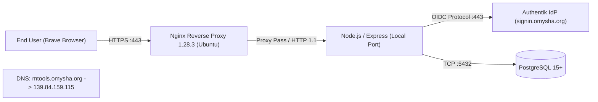
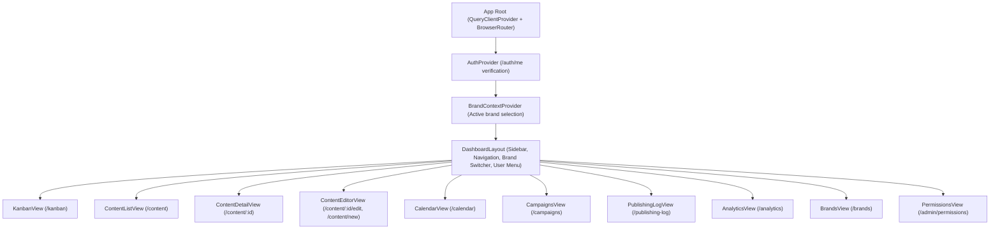
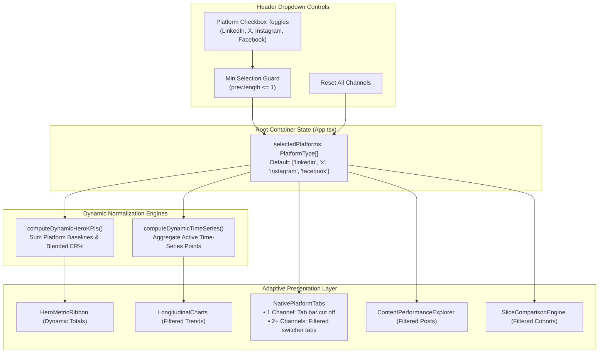

# Architecture & Authentication Blueprint

This document details the architectural topology, security boundaries, authentication lifecycle, and runtime behavior of **MarketingSupport (`mtools.omysha.org`)**.

---

## 1. Network & Deployment Topology



### Edge Characteristics
- **Server Address**: `139.84.159.115`
- **Reverse Proxy**: `nginx/1.28.3 (Ubuntu)`
- **Header Transformations**:
  - `X-Powered-By: Express` transmitted downstream.
  - SPA static assets served with `ETag` and `Cache-Control: public, max-age=0`.
  - Non-API routes fall back to `/dashboard/index.html` (SPA catch-all routing).

---

## 2. Authentication & Identity Lifecycle

The application delegates authentication to an internal **Authentik** identity provider running at `https://signin.omysha.org`.

### OIDC Configuration Parameters
| Parameter | Value Observed | Description |
| :--- | :--- | :--- |
| **Issuer** | `https://signin.omysha.org` | Authentik instance |
| **Client ID** | `AqLnfBIpBXcvG99pMIwFdexW2wxUagjLdcapxQP0` | OIDC Client registration for mtools |
| **Redirect URI** | `https://mtools.omysha.org/auth/callback` | OAuth2 callback destination |
| **Requested Scopes** | `openid profile email groups` | User identity and group membership |
| **PKCE Method** | `S256` (`code_challenge_method`) | Protection against authorization code interception |
| **Response Type** | `code` | Standard Authorization Code Flow |

### Authentication Sequence Diagram

```mermaid
sequenceDiagram
    autonumber
    actor User as User / Browser
    participant App as Express Backend (mtools)
    participant IdP as Authentik (signin.omysha.org)
    participant Google as Google Identity (SSO Provider)

    User->>App: GET /dashboard/ (no session)
    App-->>User: 302 Redirect to /auth/login?returnTo=/dashboard/
    App-->>User: 302 Redirect to Authentik /application/o/authorize?client_id=...&scope=openid+profile+email+groups
    User->>IdP: Authenticate
    opt Federated via Google
        IdP->>Google: OAuth2 redirect to accounts.google.com
        Google-->>IdP: Google OAuth2 Callback with user profile
    end
    IdP-->>User: 302 Redirect to /auth/callback?code=...&state=...
    User->>App: GET /auth/callback?code=...
    App->>IdP: POST /application/o/token/ (Exchange code for ID & Access tokens)
    IdP-->>App: { id_token, access_token, user_info }
    App->>App: Verify JWT signature, extract claims (groups, sub, email)
    App->>App: Initialize express-session in memory/store
    App-->>User: Set-Cookie: mtools_session=s:<sessionId>.<hmac>; HttpOnly; Secure; Path=/
    App-->>User: 302 Redirect to /dashboard/
    User->>App: GET /auth/me (with mtools_session cookie)
    App-->>User: 200 OK { authenticated: true, user: { ... } }
```

### Decoded User Claims Structure
Observed from live `/auth/me` endpoint:
```json
{
  "authenticated": true,
  "user": {
    "sub": "5364d7c0a525b59e4c20721b32d64d6531c027fa7a4f6b2f9717d7c9f53cbf89",
    "name": "Chandraveer Singh Solanki",
    "email": "chandraveer1601@gmail.com",
    "email_verified": true,
    "groups": [
      "team:TechProducts",
      "team:ResearchAnalysisBureau",
      "org:1",
      "product:omysha-mtools:editor",
      "product:kimai:user"
    ],
    "role": "editor"
  },
  "expires_at": 1792873831
}
```

---

## 3. Session Security & Cookie Encryption

The session cookie `mtools_session` follows the **express-session** signed cookie standard:
```
s:<session_uuid>.<hmac_sha256_signature>
```
Example:
`s:e16bapFVOkv0SoXym5xaZiD0cm9Ap3gL.KM3YJFtDOjamyP2o42v1s+2uDO3y4NeLPalWUNpVUxs`

### Client-Side Storage in Brave / Chromium (Linux)
When running on Linux under GNOME Keyring / SecretService:
1. **Secret Storage**: Keyring stores a secret labeled `"Brave Safe Storage"` with attribute `application: brave`.
   - Master Password: `CQC/kyfNwH7ATzAjayr22Q==`
2. **Key Derivation**:
   - `PBKDF2-HMAC-SHA1(passphrase, salt='saltysalt', iterations=1, dklen=16)`
3. **Cipher**:
   - AES-128-CBC with fixed IV (`Buffer.alloc(16, " ")` or 16 ASCII spaces `0x20`).
4. **Header Flag**:
   - Prefix `v11` (or `v10`) preceding encrypted payload.

---

## 4. Role-Based Access Control (RBAC)

The application maps Authentik groups (`product:omysha-mtools:<role>`) to internal roles and permissions.

### Role Matrix
| Action | Admin | Editor | Viewer |
| :--- | :---: | :---: | :---: |
| **`draft`** (Create & edit draft content) | ✅ | ✅ | ❌ |
| **`schedule`** (Set publishing date & time) | ✅ | ✅ | ❌ |
| **`publish`** (Trigger immediate social broadcast) | ✅ | ✅ | ❌ |
| **`reply`** (Post social comments/replies) | ✅ | ✅ | ❌ |
| **`delete`** (Delete content or remove from platform) | ✅ | ✅ | ❌ |
| **`scope_management`** (`/api/scope/*`) | ✅ | ❌ | ❌ |
| **`brand_connections`** (Connect OAuth apps) | ✅ | ❌ | ❌ |

When non-admins access administrative endpoints (e.g. `/api/scope/users`), the server rejects with:
```json
{
  "error": "You don’t have access to this. Ask an admin to grant you a role."
}
```

---

## 5. Frontend SPA Architecture

The client application is built with **Vite + React 18**:
- **Bundle File**: `/dashboard/assets/index-D91f_Wlo.js` (689 KB)
- **Stylesheet**: `/dashboard/assets/index-QpiRyD1W.css`
- **Root Element**: `<div id="root"></div>`

### Client Component Hierarchy



### State Management via TanStack Query (React Query)
The frontend uses granular cache keys with targeted cache invalidation:
- `["brands"]`: List of accessible brands
- `["brands", "connections"]`: Social media connection status per brand
- `["content", { brand_id, stage, ... }]`: Filtered content items
- `["content", id]`: Single content record
- `["targets", content_id]`: Platform delivery targets
- `["kanban", { brand_id }]`: Kanban column cards
- `["calendar", { start, end, brand_id }]`: Scheduled event cards
- `["inbox", { brand_id, campaign_id }]`: Engagement inbox messages
- `["analytics", "rollups", params]`: Rollup metrics (polled every 60 seconds: `refetchInterval: 6e4`)
- `["publishing-log", { brand_id }]`: Audit entries
- `["me", "permissions"]`: User permissions (staleTime: 60s)

---

## 7. Adaptive Platform Telemetry & Dynamic KPI State Engine

The command center implements an adaptive, reactive state architecture that bridges high-level executive rollups with granular, platform-specific native telemetry feeds.

### 7.1 State Machine & Flow



### 7.2 Adaptive Telemetry Rules
1. **Single-Platform Cutoff**:
   When exactly 1 channel is selected (`selectedPlatforms.length === 1`), the tab strip under the `Platform-Specific Native Telemetry` section heading is **completely cut off** (omitted from the DOM). The direct native telemetry metric cards (e.g., LinkedIn Creator Analytics, X Tweet Views, or Meta Graph API Reach) and API provenance badge render immediately beneath the heading.
2. **Multi-Platform Filtered Tabs**:
   When 2 or more channels are selected, a tab navigation bar displays buttons **exclusively for the checked platforms**. Buttons for unselected channels are stripped from the DOM.
3. **Active Tab Synchronization**:
   If the currently active tab is unchecked via the header dropdown, `activeTab` immediately switches to `selectedPlatforms[0]`, preventing orphaned views.
4. **Guaranteed Active Selection Guard**:
   Attempts to deselect the last remaining active platform are intercepted by a functional state guard, maintaining at least one active channel and preventing empty dashboard states.

