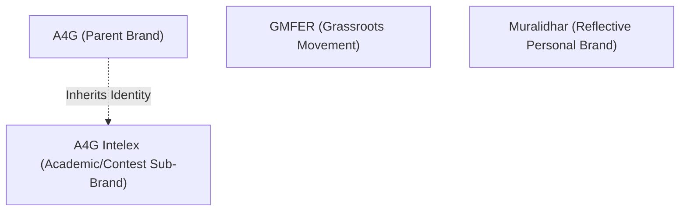
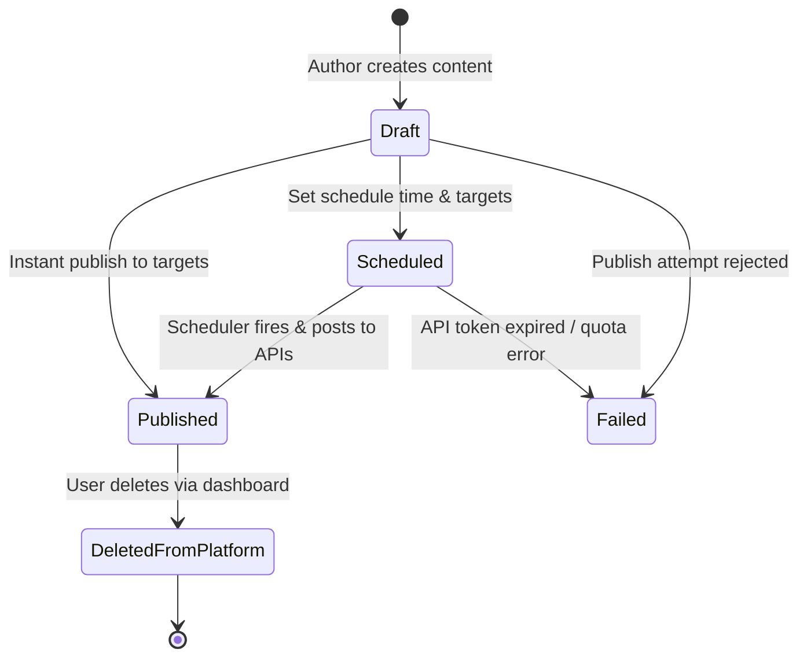

# Brand Management & Omnichannel Publishing Engine

This document details the internal design of the **Brand Configuration System**, **Content Adaptation Engine**, and **Social Media Publishing Adapters** within **MarketingSupport (`mtools`)**.

---

## 1. Multi-Brand Configuration System

Unlike generic social media schedulers, `mtools` embeds programmatic editorial governance directly into its brand definitions. Each brand carries strict constraints regarding persona, anti-patterns, linguistic blending, and visual specifications.

### 1.1 Live Brand Profiles Observed



#### 1. A4G (`slug: a4g`)
- **Tone**: Rigorous, inclusive, intellectually warm.
- **Persona**: Thought leadership platform for practitioners and contest participants.
- **Description**: A forum where serious ideas meet open access — for everyone from first-year students to seasoned professionals.
- **Primary Channels**: `["linkedin_post", "x", "facebook", "instagram"]`.
- **Palette**:
  - Primary: `#1B3A6B` (Deep trustworthy blue — intellectual authority).
  - Accent: `#E8A838` (Warm amber — openness and invitation).
  - Background: `#F7F9FC`.
- **Image Presets**: Square 1:1 (`1080x1080`), keywords: `authoritative`, `clean`, `inclusive`, `professional`.

#### 2. A4G Intelex (`slug: a4g-intelex`)
- **Parent Brand**: Inherits primary color `#1B3A6B` from A4G.
- **Contest Accent**: `#C9A84C` (Competition gold — recognition and achievement).
- **Persona**: Contest curator and academic challenger.
- **Editorial Rules**:
  1. *Be specific about contest mechanics: submission dates, word counts, judging criteria.*
  2. *Use active voice and direct address (`You`, `Your argument`, `Your entry`).*
  3. *Avoid academic jargon without definition.*
  4. *Close with a concrete call to action (submit, share, register).*
- **Anti-Patterns (Prohibited Words)**:
  `["Paradigm", "Synergy", "Leverage", "Robust", "Holistic"]`.

#### 3. GMFER (`slug: gmfer`)
- **Tone**: Bold, inclusive, action-oriented — inspires collective engagement without being preachy.
- **Tagline**: *"Building the movement — one story at a time"*.
- **Persona**: Grassroots movement builder and community mobiliser.
- **Primary Channels**: `["x", "facebook", "instagram"]`.
- **Palette**:
  - Primary: `#C0392B` (Movement red — urgency and energy).
  - Secondary: `#7D6608` (Grounding earth tone).
- **Anti-Patterns**:
  `["Leverage", "Synergy", "Ecosystem", "Robust", "Paradigm shift", "Stakeholders"]`.

#### 4. Muralidhar (`slug: muralidhar`)
- **Tone**: *Murmuring Flute* — warm, grounded, conversational, friendly.
- **Persona**: Reflective technologist based in New Delhi ("gently reflective friend sharing insights over chai").
- **Stylistic Rules**:
  1. *Always use contractions (`it's`, `doesn't`, `we're`) — never the expanded form.*
  2. *Simple words: use `not utilize`, `help not facilitate`, `show not demonstrate`.*
  3. *Hindi-English blend: weave in 1–2 italicized terms per article (`Swadharma`, `Rasa`, `Nimit`, `Kartavya`).*
  4. *Max 3 em-dashes (`—`) per article; NO semicolons.*
  5. *Structure: Flow of Four — Open with World, Pause for Depth, Bridge Inward, Close in Invitation.*
  6. *Add specific Indian details (`tapris`, `auto-rickshaws`, `Colony names`).*
  7. *Shift emotional temperature at least twice; include a moment of honest doubt.*
- **Anti-Patterns**:
  `["Furthermore", "Moreover", "Additionally", "In conclusion", "It is worth noting", "Robust", "Nuanced", "Holistic", "Leverage", "Delve"]`.

---

## 2. Omnichannel Content Publishing Engine

The core publishing workflow decouples a central **Content Item** from its platform-specific **Content Targets**.



### 2.1 The Variant Matrix
When creating a post, the author writes a master body. When targeting specific platforms, the backend generates or allows customizing tailored variants:
- **X (Twitter)**: Strictly character-constrained (280 characters), auto-appends hashtags, formats media into single or multi-card tweets.
- **LinkedIn**: Long-form commentary, professional formatting, line breaks preserved, tags formatted as `urn:li:person:...` or plain text.
- **Facebook / Instagram**: Formatted for Meta Graph API; images formatted to 1:1 or 1.91:1 aspect ratios.
- **Substack**: Formatted for newsletter delivery (title, long-form markdown, embedded cover images).

---

## 3. Platform Adapters & Integration Mechanics

### 3.1 X / Twitter Adapter
- **API Version**: Twitter API v2 (`https://api.twitter.com/2/tweets`).
- **Identifier**: Snowflake ID string (e.g. `2080182827975647594`).
- **Publishing Method**: `POST /2/tweets` with `{ "text": "...", "media": { "media_ids": [...] } }`.
- **Deletion Method**: `DELETE /2/tweets/:id`.
- **Observed Errors in Logs**:
  - `HTTP 402`: Account quota / credit exhaustion (`"Your enrolled account does not have any credits to fulfill this request"`).
  - `HTTP 403`: Access token expired or permission forbidden.

### 3.2 Meta (Facebook & Instagram) Graph API Adapter
- **API Version**: Graph API v19+ / v20.
- **Identifiers**:
  - Facebook: Compound ID `{page_id}_{post_id}` (e.g. `1161727453680961_122109513609320476`).
  - Instagram: Media container / IG Media ID (e.g. `18385820998161590`).
- **Publishing Method**:
  - Facebook: `POST /{page-id}/feed` with `message` and `link` or `attached_media`.
  - Instagram: 2-step container publishing (`POST /{ig-user-id}/media` with `image_url` ➔ `POST /{ig-user-id}/media_publish`).
- **Deletion Method**: `DELETE /{post-id}`.
- **Engagement Reply**: `POST /{comment-id}/comments` with `message`.

### 3.3 LinkedIn UGC Share Adapter
- **API Version**: LinkedIn REST / v2 UGC (`ugcPosts`).
- **Identifier**: URN string format `urn:li:share:<id>` (e.g. `urn:li:share:7457385451155542016`).
- **Author Identity**: Person URN (e.g. `urn:li:person:nuCWqp4t_Z`) or Organization URN.
- **Payload Structure**:
  ```json
  {
    "author": "urn:li:person:nuCWqp4t_Z",
    "lifecycleState": "PUBLISHED",
    "specificContent": {
      "com.linkedin.ugc.ShareContent": {
        "shareCommentary": { "text": "..." },
        "shareMediaCategory": "NONE"
      }
    },
    "visibility": {
      "com.linkedin.ugc.MemberNetworkVisibility": "PUBLIC"
    }
  }
  ```

### 3.4 Substack Manual Export Adapter
Because Substack does not offer an open public REST API for programmatic newsletter publishing:
1. The app compiles the post into a clean newsletter export: `GET /api/content/:id/substack-export`.
2. The user copies the formatted copy and media.
3. Once published manually in Substack, the user inputs the live article URL via `POST /api/content/:id/targets/substack/mark-posted`.

---

## 4. Media Pipeline & Storage

1. **Upload**: Media uploaded through `/api/content/:id/targets/:target_id/image` as `multipart/form-data`.
2. **Server Storage**: Saved to a dedicated server directory `/tmp/mtools-uploads/<uuid>.<ext>`.
3. **Serving**: Served back to clients through `/api/content/:id/image` or `/api/content/:id/targets/:platform/image` with cache-busting `?v=<timestamp>`.
4. **Social Network Delivery**: When publishing to Instagram or Facebook, the backend provides an accessible URL or uploads the file stream directly to the platform's media upload endpoint.

---

## 5. Audit Logging & Telemetry Engine

Every action is immutably appended to `publishing_logs`:
- `status`: `published`, `deleted_from_platform`, `imported`, `failed`, `dry_run`, `replied`.
- `external_id`: Remote platform ID.
- `created_by`: Name or email of operator who initiated the action.
- `response`: Full JSON response payload from the external API (or error diagnostic).

This ensures complete operational accountability and non-repudiation across multi-user teams.
