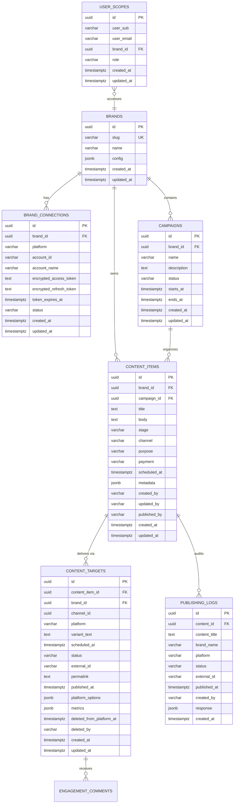

# Reconstructed Database Schema (PostgreSQL)

This document provides the reconstructed database schema for **MarketingSupport (`mtools`)**, derived from API contracts, unhandled PostgreSQL error traces, JSON serialization patterns, and payload inspection.

---

## 1. Entity-Relationship Diagram (ERD)



---

## 2. PostgreSQL DDL (Data Definition Language)

```sql
-- Enable UUID extension
CREATE EXTENSION IF NOT EXISTS "uuid-ossp";

-- ============================================================================
-- 1. Brands Table
-- ============================================================================
CREATE TABLE brands (
    id UUID PRIMARY KEY DEFAULT uuid_generate_v4(),
    slug VARCHAR(64) NOT NULL UNIQUE,
    name VARCHAR(255) NOT NULL,
    config JSONB NOT NULL DEFAULT '{}'::jsonb,
    created_at TIMESTAMPTZ NOT NULL DEFAULT NOW(),
    updated_at TIMESTAMPTZ NOT NULL DEFAULT NOW()
);

CREATE INDEX idx_brands_slug ON brands(slug);

-- ============================================================================
-- 2. Brand Social Connections Table
-- ============================================================================
CREATE TABLE brand_connections (
    id UUID PRIMARY KEY DEFAULT uuid_generate_v4(),
    brand_id UUID NOT NULL REFERENCES brands(id) ON DELETE CASCADE,
    platform VARCHAR(32) NOT NULL, -- 'linkedin', 'facebook', 'instagram', 'x', 'reddit', 'substack'
    account_id VARCHAR(255),
    account_name VARCHAR(255),
    encrypted_access_token TEXT,
    encrypted_refresh_token TEXT,
    token_expires_at TIMESTAMPTZ,
    status VARCHAR(32) NOT NULL DEFAULT 'not_connected', -- 'connected', 'not_connected', 'expired', 'error'
    created_at TIMESTAMPTZ NOT NULL DEFAULT NOW(),
    updated_at TIMESTAMPTZ NOT NULL DEFAULT NOW(),
    CONSTRAINT uq_brand_platform UNIQUE (brand_id, platform)
);

CREATE INDEX idx_brand_connections_brand_id ON brand_connections(brand_id);

-- ============================================================================
-- 3. Campaigns Table
-- ============================================================================
CREATE TABLE campaigns (
    id UUID PRIMARY KEY DEFAULT uuid_generate_v4(),
    brand_id UUID NOT NULL REFERENCES brands(id) ON DELETE CASCADE,
    name VARCHAR(255) NOT NULL,
    description TEXT,
    status VARCHAR(32) NOT NULL DEFAULT 'planned', -- 'planned', 'active', 'completed', 'archived'
    starts_at TIMESTAMPTZ,
    ends_at TIMESTAMPTZ,
    created_at TIMESTAMPTZ NOT NULL DEFAULT NOW(),
    updated_at TIMESTAMPTZ NOT NULL DEFAULT NOW()
);

CREATE INDEX idx_campaigns_brand_id ON campaigns(brand_id);
CREATE INDEX idx_campaigns_status ON campaigns(status);

-- ============================================================================
-- 4. Content Items Table
-- ============================================================================
CREATE TABLE content_items (
    id UUID PRIMARY KEY DEFAULT uuid_generate_v4(),
    brand_id UUID NOT NULL REFERENCES brands(id) ON DELETE RESTRICT,
    campaign_id UUID REFERENCES campaigns(id) ON DELETE SET NULL,
    title TEXT NOT NULL,
    body TEXT NOT NULL DEFAULT '',
    stage VARCHAR(32) NOT NULL DEFAULT 'draft', -- 'draft', 'scheduled', 'published', 'archived'
    channel VARCHAR(64), -- primary initial channel (e.g. 'facebook', 'x', 'linkedin_post')
    purpose VARCHAR(64) DEFAULT 'visibility', -- 'visibility', 'credibility', 'conversion'
    payment VARCHAR(32) DEFAULT 'organic', -- 'organic', 'paid'
    scheduled_at TIMESTAMPTZ,
    metadata JSONB NOT NULL DEFAULT '{}'::jsonb,
    created_by VARCHAR(255) NOT NULL,
    updated_by VARCHAR(255),
    published_by VARCHAR(255),
    created_at TIMESTAMPTZ NOT NULL DEFAULT NOW(),
    updated_at TIMESTAMPTZ NOT NULL DEFAULT NOW()
);

CREATE INDEX idx_content_brand_id ON content_items(brand_id);
CREATE INDEX idx_content_stage ON content_items(stage);
CREATE INDEX idx_content_scheduled_at ON content_items(scheduled_at);
CREATE INDEX idx_content_campaign_id ON content_items(campaign_id);

-- ============================================================================
-- 5. Content Delivery Targets Table (Platform-Specific Variants)
-- ============================================================================
CREATE TABLE content_targets (
    id UUID PRIMARY KEY DEFAULT uuid_generate_v4(),
    content_item_id UUID NOT NULL REFERENCES content_items(id) ON DELETE CASCADE,
    brand_id UUID NOT NULL REFERENCES brands(id) ON DELETE CASCADE,
    channel_id UUID,
    platform VARCHAR(32) NOT NULL, -- 'linkedin_post', 'x', 'facebook', 'instagram', 'reddit', 'substack'
    variant_text TEXT,
    scheduled_at TIMESTAMPTZ,
    status VARCHAR(32) NOT NULL DEFAULT 'draft', -- 'draft', 'scheduled', 'published', 'failed'
    external_id VARCHAR(255), -- Social network post ID / URN
    permalink TEXT,
    published_at TIMESTAMPTZ,
    platform_options JSONB NOT NULL DEFAULT '{}'::jsonb, -- e.g. {"image_url": "/tmp/mtools-uploads/..."}
    metrics JSONB NOT NULL DEFAULT '{}'::jsonb, -- e.g. {"likes": 12, "impressions": 300, ...}
    deleted_from_platform_at TIMESTAMPTZ,
    deleted_by VARCHAR(255),
    created_at TIMESTAMPTZ NOT NULL DEFAULT NOW(),
    updated_at TIMESTAMPTZ NOT NULL DEFAULT NOW()
);

CREATE INDEX idx_targets_content_item_id ON content_targets(content_item_id);
CREATE INDEX idx_targets_scheduled_pending ON content_targets(status, scheduled_at) WHERE status = 'scheduled';
CREATE INDEX idx_targets_external_id ON content_targets(external_id);

-- ============================================================================
-- 6. Publishing Audit Logs Table
-- ============================================================================
CREATE TABLE publishing_logs (
    id UUID PRIMARY KEY DEFAULT uuid_generate_v4(),
    content_id UUID NOT NULL REFERENCES content_items(id) ON DELETE CASCADE,
    content_title TEXT NOT NULL,
    brand_name VARCHAR(255) NOT NULL,
    platform VARCHAR(32) NOT NULL,
    status VARCHAR(32) NOT NULL, -- 'published', 'deleted_from_platform', 'imported', 'failed', 'dry_run', 'replied'
    external_id VARCHAR(255),
    published_at TIMESTAMPTZ,
    created_by VARCHAR(255) NOT NULL,
    response JSONB NOT NULL DEFAULT '{}'::jsonb,
    created_at TIMESTAMPTZ NOT NULL DEFAULT NOW()
);

CREATE INDEX idx_pub_logs_content_id ON publishing_logs(content_id);
CREATE INDEX idx_pub_logs_created_at ON publishing_logs(created_at DESC);

-- ============================================================================
-- 7. User Scopes & Permissions Table
-- ============================================================================
CREATE TABLE user_scopes (
    id UUID PRIMARY KEY DEFAULT uuid_generate_v4(),
    user_sub VARCHAR(255) NOT NULL, -- Authentik user subject ID
    user_email VARCHAR(255) NOT NULL,
    brand_id UUID REFERENCES brands(id) ON DELETE CASCADE, -- NULL indicates global/all brands
    role VARCHAR(32) NOT NULL DEFAULT 'editor', -- 'admin', 'editor', 'viewer'
    created_at TIMESTAMPTZ NOT NULL DEFAULT NOW(),
    updated_at TIMESTAMPTZ NOT NULL DEFAULT NOW(),
    CONSTRAINT uq_user_brand UNIQUE (user_sub, brand_id)
);

CREATE INDEX idx_user_scopes_sub ON user_scopes(user_sub);
```

---

## 3. JSONB Structures Deep Dive

### 3.1 `brands.config`
The `config` column stores brand identity, tone of voice, style guides, and design tokens:
```json
{
  "voice": {
    "tone": "Rigorous, inclusive, intellectually warm",
    "persona": "Thought leadership platform for practitioners",
    "description": "A forum where serious ideas meet open access",
    "rules": [
      "Always use contractions (it's, doesn't, we're)",
      "Simple words: use not utilize, help not facilitate",
      "Structure: Flow of Four — Open with World, Pause for Depth, Bridge Inward, Close in Invitation"
    ],
    "anti_patterns": [
      "Paradigm",
      "Synergy",
      "Leverage",
      "Robust",
      "Delve"
    ],
    "hindi_terms": ["Swadharma", "Rasa", "Nimit", "Kartavya"]
  },
  "tagline": "Building the movement — one story at a time",
  "channels": ["linkedin_post", "x", "facebook", "instagram"],
  "color_palette": {
    "primary": { "hex": "#1B3A6B", "description": "Deep trustworthy blue" },
    "accent": { "hex": "#E8A838", "description": "Warm amber" },
    "background": "#F7F9FC"
  },
  "image_presets": {
    "linkedin_post": {
      "ratio": "1:1",
      "width": 1080,
      "height": 1080,
      "description": "Square format for feeds",
      "style_keywords": ["authoritative", "clean", "professional"]
    },
    "x_post": {
      "ratio": "16:9",
      "width": 1200,
      "height": 675,
      "description": "Landscape widescreen for tweets",
      "style_keywords": ["bold", "grassroots", "action"]
    }
  },
  "default_purpose_mix": ["visibility", "credibility"]
}
```

### 3.2 `content_targets.platform_options`
Stores target-specific publishing parameters such as local media paths:
```json
{
  "image_url": "/tmp/mtools-uploads/b8198232-3cc0-4c08-9f0b-d87f2349a998.png"
}
```

### 3.3 `content_targets.metrics`
Stores engagement telemetry harvested from social APIs:
```json
{
  "likes": 42,
  "shares": 15,
  "comments": 8,
  "impressions": 1420,
  "clicks": 95,
  "engagement_rate": 0.045
}
```

### 3.4 `publishing_logs.response`
Records the raw payload or API outcome from third-party networks:
- **Successful Publish (X / Twitter)**:
  ```json
  {
    "permalink": "https://x.com/i/status/2080182827975647594"
  }
  ```
- **Successful Publish (Instagram)**:
  ```json
  {
    "permalink": "https://www.instagram.com/p/DbIDwpHmyXG/"
  }
  ```
- **Platform Error (X API Quota)**:
  ```json
  {
    "error": "X API error HTTP 402: Your enrolled account [2066499004574101504] does not have any credits to fulfill this request."
  }
  ```
- **Platform Reply Action**:
  ```json
  {
    "message": "❤️",
    "in_reply_to": "122105882241320476_1388793936470317"
  }
  ```
- **Platform Deletion**:
  ```json
  {
    "deleted": true,
    "raw_response": { "data": { "deleted": true } }
  }
  ```
