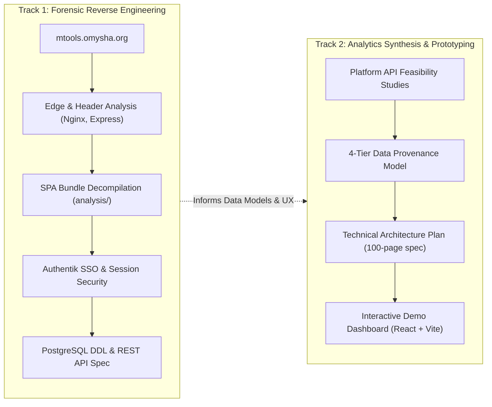
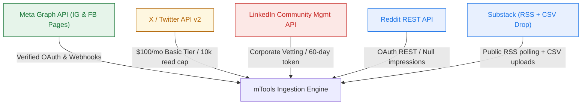
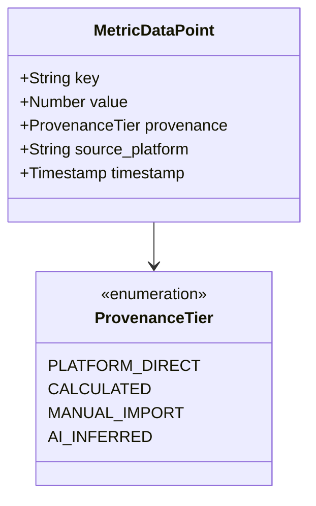
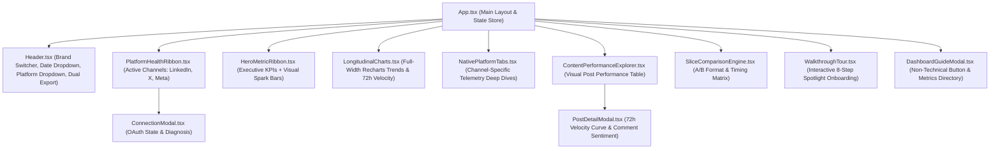

# Methodology & System Architecture Guide: mTools

> **Comprehensive Technical Methodology, Architectural Blueprints, Cross-Platform Feasibility, and Execution Runbook**

---

## 1. Executive Summary & Methodological Principles

This document articulates the end-to-end methodology applied across **MarketingSupport (`mtools`)**, an enterprise-grade social media command center, content orchestration pipeline, and unified analytics platform built for **Omysha** organizations (*A4G*, *A4G Intelex*, *GMFER*, and *Muralidhar*).

The project is governed by a **dual-track methodology**:
1. **Forensic Reverse Engineering Track**: Deconstruction of the live, production web application hosted at `mtools.omysha.org`, extracting its edge topology, SPA client bundles, authentication mechanisms, database models, and REST contracts without direct access to original server repositories.
2. **Forward-Looking Analytics Engine & Prototyping Track**: Technical feasibility research and architectural synthesis for a multi-platform social analytics engine across six major ecosystems (**LinkedIn**, **X/Twitter**, **Instagram**, **Facebook**, **Substack**, **Reddit**), culminating in an interactive, high-fidelity **React 18 + Vite** demonstration dashboard (`demo-dashboard/`).



---

## 2. Phase 1: Forensic Reverse Engineering Methodology

The reverse engineering of `mtools.omysha.org` was conducted using non-destructive network observation, runtime DOM inspection, cryptographic analysis of client session stores, and AST-based bundle beautification.

### 2.1 Edge & Network Infrastructure Fingerprinting
- **DNS & Server Routing**: Probing `mtools.omysha.org` revealed resolution to `139.84.159.115`.
- **Proxy Identification**: HTTP response headers identified `nginx/1.28.3 (Ubuntu)`.
- **Upstream Application Runtime**: Downstream response headers contained `X-Powered-By: Express`, confirming a Node.js Express server running behind Nginx.
- **Static Asset Caching**: JavaScript and CSS chunks were delivered with `Cache-Control: public, max-age=0` and content-hashed filenames (`index-D91f_Wlo.js`), characteristic of Vite-generated production builds.

### 2.2 Client Bundle Extraction & Deobfuscation
The production assets were harvested into the [`analysis/`](file:///home/laptup/Dev/mtools/analysis) directory:
- `index-D91f_Wlo.js` (689 KB raw minified bundle).
- `index-QpiRyD1W.css` (61 KB compiled Tailwind CSS utility bundle).
- `index.beautified.js` (1.2 MB / ~34,500 lines of formatted JavaScript).

Through Abstract Syntax Tree (AST) scanning and symbol recovery, the client architecture was mapped:
- **Framework**: React 18 with React DOM.
- **Routing**: React Router DOM v6, implementing protected layout routes (`<ProtectedRoute>`, `<DashboardLayout>`).
- **Data Fetching & Cache**: TanStack React Query v5 with query keys such as `["brands"]`, `["content"]`, `["campaigns"]`, `["publishing_logs"]`.
- **UI System**: Tailwind CSS v3 with Radix UI headless primitives and Lucide React icons.

### 2.3 Authentication Lifecycle & Session Cryptography
The application implements single sign-on (SSO) delegated to an internal **Authentik** identity provider at `signin.omysha.org`.
1. **OIDC Handshake**: Unauthenticated requests to `/dashboard` trigger a `302 Found` redirect to `/auth/login`, initiating an OpenID Connect Authorization Code flow with Authentik.
2. **Session Cookie**: Successful authentication yields an `mtools_session` HTTP cookie with flags `HttpOnly; Secure; SameSite=Lax`.
3. **Session Signature**: The cookie follows the `express-session` format (`s:<sessionId>.<hmac_sha256>`).
4. **Client-Side Safe Storage**: Under Chromium/Brave environments, session tokens stored in the browser's cookie jar are encrypted at rest using OS-level credentials via AES-128-CBC (`chrome_libsecret_os_crypt_password_v2`).
5. **Role-Based Access Control (RBAC)**: User profile claims extracted via `GET /auth/me` return group memberships (`product:omysha-mtools:editor`, `org:1`, `team:TechProducts`), mapping to an internal `editor` or `admin` role.

### 2.4 Relational Database Schema Reconstruction
Although direct database credentials were not exposed, the PostgreSQL schema was deduced through:
- **Error Signatures**: Parameter fuzzing produced unhandled PostgreSQL syntax errors (`ERROR: invalid input syntax for type uuid: "test"`), verifying UUID primary keys.
- **Timestamp Formats**: Microsecond UTC ISO timestamps (`YYYY-MM-DDTHH:MM:SS.ffffff+00:00`) confirmed PostgreSQL's `TIMESTAMPTZ`.
- **JSON Operators**: Filter queries confirmed PostgreSQL `JSONB` column storage for brand configurations and target platform metadata.
- **DDL Reconstruction**: Documented in [`DATABASE_SCHEMA.md`](file:///home/laptup/Dev/mtools/DATABASE_SCHEMA.md), defining 8 core tables: `brands`, `brand_connections`, `campaigns`, `content_items`, `content_targets`, `publishing_logs`, `engagement_comments`, and `user_scopes`.

### 2.5 REST API Contract Discovery
Systematic observation of client-server requests mapped 36+ endpoints documented in [`API_SPECIFICATION.md`](file:///home/laptup/Dev/mtools/API_SPECIFICATION.md), categorized into:
- `/auth/*`: Session validation, login, callback, and logout.
- `/api/brands/*`: Multi-brand CRUD, brand settings, and social account connections.
- `/api/campaigns/*`: Campaign groupings and editorial scheduling.
- `/api/content/*`: Post authoring, platform-specific variants, and image uploads.
- `/api/targets/*`: Target publishing states (`draft`, `scheduled`, `published`, `failed`).
- `/api/logs/*`: Audit trails capturing third-party platform responses and error codes.
- `/api/comments/*`: Inbound comment streams and direct reply actions.
- `/api/analytics/*`: Cross-platform metrics aggregation and rollups.

---

## 3. Phase 2: Cross-Platform Feasibility & Telemetry Normalization

Consolidating analytics across six heterogeneous social ecosystems requires handling disparate authentication mechanisms, developer vetting processes, commercial tiers, and API constraints. 

Full technical research is documented in [`mTools Technical Architecture Plan.md`](file:///home/laptup/Dev/mtools/mTools%20Technical%20Architecture%20Plan.md). Below is the feasibility framework:



### 3.1 Platform Profiles & Operational Boundaries

#### 1. Meta (Instagram Professional & Facebook Pages) — High Feasibility
- **Endpoint**: Meta Graph API v26.0 (`graph.facebook.com`).
- **Authentication**: 60-day exchangeable Page tokens; permanent System User tokens available via Meta Business Suite.
- **Capabilities**: Full publishing (images, carousels, reels), comment listening, and comprehensive insights (Reach, Impressions, Saved Posts, Profile Visits).
- **Constraint**: Personal Instagram and personal Facebook profiles are completely unsupported; all accounts must be converted to Professional/Business accounts linked to an active Facebook Page.

#### 2. X (Twitter) API v2 — Commercial Gating
- **Endpoint**: `api.twitter.com/2/`.
- **Authentication**: OAuth 2.0 Authorization Code with PKCE, automated refresh tokens.
- **Capabilities**: Publishing tweets and media, post metrics (retweets, replies, likes, quotes, impressions, bookmarks).
- **Constraint**: The Free API tier provides zero read capabilities. Ingestion requires the **Basic Tier ($100/month)**, capped at **10,000 read posts monthly** and subject to stringent 15-minute rate-limit windows.

#### 3. LinkedIn — Conditional Access
- **Endpoint**: `api.linkedin.com/rest/` via LinkedIn Marketing Solutions.
- **Authentication**: 3-Legged OAuth 2.0. Standard tokens expire every 60 days without automated refresh tokens.
- **Capabilities**: Publishing company/member posts with carousels; post analytics via `memberCreatorPostAnalytics` and `organizationalEntityAcls`.
- **Constraint**: Accessing creator post analytics requires developer approval for the **Community Management API**, a restricted enterprise product requiring formal corporate vetting.

#### 4. Substack — Asymmetric / Hybrid
- **Endpoint**: Public RSS (`<publication>.substack.com/feed`).
- **Capabilities**: Reading published post titles, dates, descriptions, and canonical URLs.
- **Constraint**: Substack has no public developer API for private telemetry (paid/free subscriber counts, open rates, email CTRs). Ingestion requires a hybrid architecture: automated RSS polling for public posts combined with a drag-and-drop ingestion pipeline for native creator CSV exports (`posts.csv`, `subscribers.csv`).

#### 5. Reddit — Partial Telemetry
- **Endpoint**: `oauth.reddit.com/`.
- **Capabilities**: Fetching submitted threads, comment hierarchy trees, net upvote scores, and upvote ratios.
- **Constraint**: Reddit restricts post impressions and view counts to internal GraphQL queries, returning `null` on the public REST API. Aggregating Reddit scores directly into "Impressions" creates false equivalence.

---

## 4. Phase 3: The 4-Tier Data Provenance Framework

To maintain data integrity and prevent inaccurate executive rollups, mTools enforces a **Strict Provenance Boundary**. Every data point ingested, calculated, or displayed is tagged with its provenance tier:



1. **`platform_direct` (Verified API Telemetry)**:
   - Untampered values received directly over authenticated platform APIs.
   - *Examples*: Meta Graph API `reach`, LinkedIn `impressions`, X `retweet_count`.
2. **`calculated` (Derived Analytics)**:
   - Normalized metrics computed using verified mathematical algorithms.
   - *Examples*: Blended Engagement Rate, Cross-Platform Publication Velocity, 72-hour progression curves.
   - *Formula*:
     $$\text{Blended Engagement Rate} = \frac{\sum (\text{Likes} + \text{Comments} + \text{Shares} + \text{Clicks})}{\sum \text{Impressions (platforms with verified impressions)}} \times 100$$
3. **`manual_import` (Drop-Zone File Ingestion)**:
   - Data ingested from authoritative platform exports.
   - *Examples*: Substack `subscribers.csv` (active paid tier counts, open rates).
4. **`ai_inferred` (Algorithmic / Generative Intelligence)**:
   - Non-deterministic semantic analysis and predictive guidance.
   - *Examples*: Comment sentiment classification (`positive`, `neutral`, `question`), automated content tone audit, anomaly detection alerts.

---

## 5. Phase 4: Code Stack & Component Architecture

### 5.1 Technology Comparison

| Dimension | Interactive Demo (`demo-dashboard`) | Production Application (`mtools.omysha.org`) | Target Analytics Engine |
| :--- | :--- | :--- | :--- |
| **Language** | TypeScript 5.6 | JavaScript (ES2022) | Python 3.11+ / TypeScript |
| **Frontend Framework** | React 18.3 | React 18 SPA | React 18 SPA |
| **Bundler** | Vite 5.4 | Vite | Vite |
| **CSS Framework** | Tailwind CSS 3.4 + PostCSS | Tailwind CSS + Radix UI | Tailwind CSS + Radix UI |
| **Visualization** | Recharts 2.13 (Responsive SVG) | Canvas + SVG rollups | Recharts + ECharts |
| **Icons** | Lucide React 0.453 | Lucide React | Lucide React |
| **HTTP / Data Fetching** | In-Memory Reactive State | TanStack Query v5 + Fetch | TanStack Query v5 + Axios |
| **Backend Runtime** | Simulated In-Browser Services | Node.js + Express | FastAPI (Async Python) |
| **Task / Queue Engine** | Simulated timers | Node process background worker | Celery + Redis |
| **Database** | In-Memory Typed Schema | PostgreSQL 15+ (UUIDs, JSONB) | PostgreSQL + Partitions |

---

## 6. Phase 5: Interactive Prototype Design (`demo-dashboard`)

The [`demo-dashboard`](file:///home/laptup/Dev/mtools/demo-dashboard) web application translates the technical research and data models into an interactive, real-time command center.

### 6.1 Component Topology



### 6.2 Key Features & Interactions
1. **Multi-Brand Context Switching**:
   - Easily toggle between **A4G**, **A4G Intelex**, **GMFER**, and **Muralidhar**.
   - Switching brands dynamically swaps account connections, platform health statuses, and post streams.
2. **Compact Dropdown Navigation**:
   - Replaced text-heavy pill capsules with clean dropdown selectors for **Date Range** (`7d`, `30d`, `90d`, `ytd`) and **Platforms** (multi-select filter with active counts).
3. **Dual Export Engine (PDF & Markdown)**:
   - Dedicated top-right **Export** button providing instant downloads:
     - **Export as PDF**: Triggers native browser print formatted via `@media print` CSS for an executive-ready landscape brief (hiding controls, headers, and UI clutter).
     - **Export as Markdown (.md)**: Dynamically generates a complete structured Markdown report with executive KPI tables, active channel statuses, and top content performance.
4. **Visual-First Executive KPI Strip**:
   - Replaced verbose text footnotes with visual spark/progress bars, colored percentage delta chips, and unobtrusive hover info tooltips (`Info`).
5. **Full-Width Performance Evolution & 72h Velocity**:
   - Expanded the time-series charts to full width (100%), offering rich visualization of 30-day aggregates and early 72-hour decay curves.
6. **Alpha Channel Isolation (Substack & Reddit Under the Hood)**:
   - Substack and Reddit integrations are maintained in domain types and mock models for future activation, but completely hidden from the active UI to keep current operational telemetry focused on verified channels (LinkedIn, X, Instagram, Facebook).
7. **Content Performance & Strategic A/B Slicing**:
   - Visual post table featuring format chips and colored ER% badges, with deep-dive modal inspection and comparative A/B cohort analysis.

---

## 7. Phase 6: Execution Runbook (How to Run the Web Page)

Follow these instructions to run, build, and inspect the web application locally.

### 7.1 Environment Prerequisites
Ensure the system has modern Node.js and npm installed:
```bash
node -v   # Expected: v18.0.0 or higher (v24.21.0 confirmed)
npm -v    # Expected: v9.0.0 or higher (11.19.0 confirmed)
```

### 7.2 Running Development Server

```bash
# 1. Navigate to the demo dashboard directory
cd /home/laptup/Dev/mtools/demo-dashboard

# 2. Start the Vite development server
npm run dev
```

#### Terminal Output:
```
  VITE v5.4.21  ready in ~300 ms

  ➜  Local:   http://localhost:5173/
  ➜  Network: http://<local-ip>:5173/
  ➜  press h + enter to show help
```

Open `http://localhost:5173` in your browser.

### 7.3 Building for Production & Verification

```bash
cd /home/laptup/Dev/mtools/demo-dashboard

# Run TypeScript compilation and production packaging
npm run build
```

#### Expected Build Results:
```
✓ 2380 modules transformed.
dist/index.html                   1.01 kB │ gzip:   0.59 kB
dist/assets/index-*.css          23.80 kB │ gzip:   5.09 kB
dist/assets/index-*.js          622.36 kB │ gzip: 175.33 kB
✓ built in ~7s
```

### 7.4 Previewing the Production Build

```bash
cd /home/laptup/Dev/mtools/demo-dashboard

npm run preview
```
Vite will serve the compiled bundle from `dist/` on `http://localhost:4173`.

### 7.5 Network & Port Troubleshooting

- **Port in Use (`EADDRINUSE: 5173`)**: If port 5173 is occupied, Vite will automatically try the next available port (`5174`). You can also specify a custom port:
  ```bash
  npm run dev -- --port 3000
  ```
- **External / LAN Access**: `demo-dashboard/vite.config.ts` has `server.host: true` enabled by default, making the dashboard accessible across your local network.

### 7.6 Automated Browser QA Verification (Playwright E2E)

To ensure UI reactivity, telemetry cutoff dynamics, and state integrity remain regression-free, an automated end-to-end browser QA suite is implemented in [`demo-dashboard/e2e/browser-qa.mjs`](file:///home/laptup/Dev/mtools/demo-dashboard/e2e/browser-qa.mjs) utilizing Playwright and headless Chromium.

#### Test Suites Verified:
1. **Initial Load & Default Selection**: Validates that all 4 active platforms (`LinkedIn`, `X`, `Instagram`, `Facebook`) are selected, all 4 telemetry tabs render, and baseline Hero Impressions equal 184,520.
2. **Single-Platform Tab Cutoff**: Unchecks X, Instagram, and Facebook, verifying that the tab navigation bar is **completely cut off / hidden** from the DOM while LinkedIn's native telemetry cards render directly, with Hero Impressions recalculating to 68,200.
3. **Empty State Guard**: Attempts to uncheck the final remaining platform (LinkedIn), verifying that the state guard intercepts the action and preserves the active channel.
4. **Multi-Platform Filtered Tabs**: Selects a subset (LinkedIn + Instagram), verifying that the tab bar reappears with strictly 2 buttons and correctly excludes unselected channels.
5. **Reset Action**: Verifies that clicking "Reset All" re-enables all 4 channels and restores all 4 telemetry tabs.
6. **Walkthrough Tour & Adaptive Telemetry Spotlight**: Validates navigation through all 9 tour steps, confirming updated scope descriptions and targeted spotlight framing on `#platform-telemetry`.

```bash
# Execute the automated browser QA test runner
cd demo-dashboard
node e2e/browser-qa.mjs
```

---

## 8. Summary of Documentation Artifacts

| Document | Primary Focus | Link |
| :--- | :--- | :--- |
| **Master README** | Repository guide, stack matrix, quickstart | [`README.md`](file:///home/laptup/Dev/mtools/README.md) |
| **System Methodology** | Investigative methods, feasibility, provenance | [`METHODOLOGY.md`](file:///home/laptup/Dev/mtools/METHODOLOGY.md) |
| **Reverse Engineering Dossier**| Original findings from `mtools.omysha.org` | [`REVERSE_ENGINEERING.md`](file:///home/laptup/Dev/mtools/REVERSE_ENGINEERING.md) |
| **Architecture Blueprint** | SSO OIDC, network topology, session store | [`ARCHITECTURE.md`](file:///home/laptup/Dev/mtools/ARCHITECTURE.md) |
| **Database Schema** | PostgreSQL DDL, UUID keys, JSONB models | [`DATABASE_SCHEMA.md`](file:///home/laptup/Dev/mtools/DATABASE_SCHEMA.md) |
| **API Specification** | 36+ REST endpoint contracts and examples | [`API_SPECIFICATION.md`](file:///home/laptup/Dev/mtools/API_SPECIFICATION.md) |
| **Brand & Content Engine** | Multi-brand voice governance, adapters | [`BRAND_AND_CONTENT_ENGINE.md`](file:///home/laptup/Dev/mtools/BRAND_AND_CONTENT_ENGINE.md) |
| **Technical Architecture Plan**| 100-page cross-platform feasibility analysis | [`mTools Technical Architecture Plan.md`](file:///home/laptup/Dev/mtools/mTools%20Technical%20Architecture%20Plan.md) |
| **Web Dashboard Source** | React 18 + Vite interactive analytics prototype | [`demo-dashboard/`](file:///home/laptup/Dev/mtools/demo-dashboard) |
