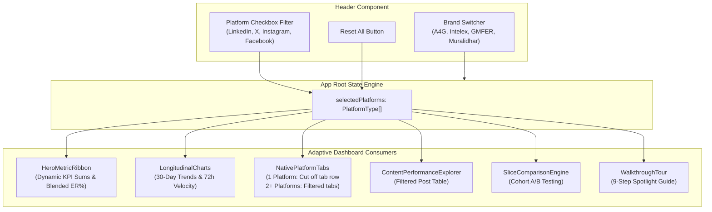

# mTools (MarketingSupport)

> **Enterprise Multi-Brand Social Media Marketing, Content Orchestration & Omnichannel Analytics Command Center**

---

## 📌 Executive Summary

**MarketingSupport (`mtools`)** is an enterprise-grade social media command center engineered for **Omysha** organizations and initiatives—including **A4G (Action for Growth)**, **A4G Intelex**, **GMFER**, and **Muralidhar**.

The platform bridges editorial governance, automated cross-platform distribution, and unified multi-platform analytics across four major live communication ecosystems: **LinkedIn**, **X (formerly Twitter)**, **Instagram**, and **Facebook**, with pipeline support for **Substack** and **Reddit**.

This repository serves as both the **engineering blueprint** and **interactive prototype** for the platform, containing:
1. **Interactive Web Dashboard Prototype (`demo-dashboard/`)**: A modern **React 18 + TypeScript + Vite + Tailwind CSS** application demonstrating unified multi-brand analytics, adaptive platform-specific telemetry, dynamic Hero KPI calculations, and 72-hour viral velocity curves.
2. **Automated Playwright Browser QA Suite (`demo-dashboard/e2e/browser-qa.mjs`)**: Complete headless browser end-to-end test suite validating UI reactivity, tab cutoff dynamics, and user interaction flows.
3. **Architectural & Technical Specifications**: Complete blueprints covering system architecture, database DDL schemas, REST API contracts, and brand governance.
4. **Forensic Reverse-Engineering Dossiers**: Deep-dive analysis of network topology, Authentik OIDC SSO federation, and PostgreSQL signatures discovered on `mtools.omysha.org`.

---

## 📂 Documentation Directory & Architectural Blueprints

| Document | Purpose & Description |
| :--- | :--- |
| **[`ARCHITECTURE.md`](file:///home/laptup/Dev/mtools/ARCHITECTURE.md)** | Client-server architecture, Authentik SSO OIDC authentication flow, session security, Vite+React SPA architecture, RBAC rules, and the **Adaptive Telemetry & Dynamic KPI State Engine**. |
| **[`API_SPECIFICATION.md`](file:///home/laptup/Dev/mtools/API_SPECIFICATION.md)** | Exhaustive documentation of all 36+ REST API endpoints, HTTP methods, authentication headers, request/response models, and live payload examples. |
| **[`DATABASE_SCHEMA.md`](file:///home/laptup/Dev/mtools/DATABASE_SCHEMA.md)** | Complete PostgreSQL schema DDL (`CREATE TABLE`), native UUIDv4 keys, JSONB schemas, foreign keys, and performant indexes. |
| **[`BRAND_AND_CONTENT_ENGINE.md`](file:///home/laptup/Dev/mtools/BRAND_AND_CONTENT_ENGINE.md)** | Multi-brand voice governance, content adapters, image aspect ratio rules, social publisher adapters, engagement inbox, and audit logging. |
| **[`METHODOLOGY.md`](file:///home/laptup/Dev/mtools/METHODOLOGY.md)** | Forensic reverse engineering methodology, 4-tier data provenance framework, prototype architecture, and Playwright automated verification. |
| **[`REVERSE_ENGINEERING.md`](file:///home/laptup/Dev/mtools/REVERSE_ENGINEERING.md)** | Investigation dossier covering live network discoveries on `mtools.omysha.org`, Nginx proxying, Authentik token encryption, and database signatures. |
| **[`mTools Technical Architecture Plan.md`](file:///home/laptup/Dev/mtools/mTools%20Technical%20Architecture%20Plan.md)** | Comprehensive 100-page engineering roadmap and technical execution plan ([PDF version available](file:///home/laptup/Dev/mtools/mTools%20Technical%20Architecture%20Plan.pdf)). |
| **[`analysis/`](file:///home/laptup/Dev/mtools/analysis)** | Deobfuscated and beautified client-side JavaScript and CSS bundles extracted from the live production system. |

---

## ✨ Interactive Dashboard Features



### 1. Unified Checkbox Platform Filter
- **Central Dashboard Filter**: Located in the top-right header, filtering all analytics in real time.
- **Default State**: Selects all 4 channels (`LinkedIn`, `X`, `Instagram`, `Facebook`) on initial load.
- **Guaranteed Active Selection**: A safety guard prevents deselecting the final platform, displaying a `(Required)` badge to ensure the dashboard never enters an empty or broken state.
- **1-Click Reset**: "Reset All" button immediately restores all channels.

### 2. Adaptive Platform-Specific Native Telemetry
- **Single Channel Isolated**: The tab navigation bar and social media naming under the heading is **completely cut off** (hidden), displaying the channel's native metrics cards directly without clutter.
- **Multiple Channels Selected (2–4)**: A clean tab bar renders buttons **strictly for the checked channels**, omitting unselected networks.
- **Automatic Fallback**: If an active platform is unchecked, the view immediately shifts focus to the first available selected channel.

### 3. Executive Hero KPI Ribbon
- Dynamically calculated from verified platform-level baseline metrics:
  - **Gross Impressions**: LinkedIn (68,200) + X (45,100) + Instagram (42,320) + Facebook (28,900) = 184,520
  - **Unique Reach**: LinkedIn (48,500) + Instagram (41,200) + Facebook (31,700) = 121,400 (X omitted per API v2 limitations)
  - **Total Engagements**: LinkedIn (6,450) + X (3,240) + Instagram (4,520) + Facebook (2,630) = 16,840
  - **Blended Engagement Rate**: Scaled dynamically based on active channel impressions and engagements.
  - **Publication Velocity & Audience Growth**: Aggregated across active accounts.

### 4. Longitudinal Charts & 72h Viral Velocity
- **30-Day Performance Evolution**: Area chart tracking Impressions, Engagements, and Engagement Rate dynamically normalized by active platform.
- **72-Hour Velocity Dynamics**: Curve modeling early viral momentum and engagement decay.

### 5. Content Performance Explorer & A/B Slicing
- Searchable and sortable post performance table showing impressions, reach, reactions, comments, and ER%.
- Strategic A/B Slice Comparison engine testing content formats (Carousels vs. Text) and campaign objectives.

### 6. 9-Step Interactive Spotlight Tour & Guide Modal
- Built-in onboarding tour guiding users through all dashboard controls with SVG cutout backdrops and spotlight glowing frames.
- Includes a dedicated step for **Adaptive Platform Telemetry** explaining the single vs. multi-channel visualization patterns.

---

## 💻 Tech Stack

- **Frontend Framework**: React 18.3 (TypeScript 5.6)
- **Build Tooling & Dev Server**: Vite 5.4 + PostCSS
- **Styling**: Tailwind CSS 3.4
- **Icons**: Lucide React
- **Data Visualization**: Recharts 2.13
- **Automated Browser Testing**: Playwright (Headless Chromium)

---

## 🚀 Quickstart

### Prerequisites
- **Node.js**: v18.0.0 or higher (tested on Node v24)
- **npm**: v9.0.0 or higher

### 1. Installation

```bash
# Navigate to the dashboard directory
cd demo-dashboard

# Install dependencies
npm install
```

### 2. Development Server

```bash
npm run dev
```

Open your browser at:
```
http://localhost:5173
```

### 3. Production Build & Preview

```bash
# Typecheck and compile optimized bundle
npm run build

# Preview production build locally
npm run preview
```

### 4. Automated Browser QA Testing

Execute the automated Playwright end-to-end browser test suite:

```bash
cd demo-dashboard
node e2e/browser-qa.mjs
```

The test runner will automatically start a preview server, launch headless Chromium, and validate:
1. Default all-platform selection and 184,520 impressions.
2. Single-platform tab cutoff (confirming tab buttons are hidden and direct metrics display).
3. Empty state guard preventing unchecking the last platform.
4. Multi-platform filtered tabs (displaying only checked platforms).
5. Reset button restoring all 4 channels.
6. 9-step Walkthrough Tour navigation and Adaptive Telemetry spotlight.

---

## 📂 Project Structure

```
.
├── .gitignore
├── README.md                              # Main documentation hub
├── ARCHITECTURE.md                        # System architecture & adaptive telemetry specs
├── API_SPECIFICATION.md                   # 36+ REST endpoint contracts
├── DATABASE_SCHEMA.md                     # PostgreSQL schema DDL & JSONB models
├── BRAND_AND_CONTENT_ENGINE.md            # Multi-brand voice & publishing engine
├── METHODOLOGY.md                         # Forensic methodology & provenance model
├── REVERSE_ENGINEERING.md                 # Reverse engineering dossier
├── mTools Technical Architecture Plan.md  # 100-page engineering roadmap
├── mTools Technical Architecture Plan.pdf # PDF architecture document
├── analysis/                              # Beautified client-side source bundles
└── demo-dashboard/                        # Interactive React analytics application
    ├── package.json
    ├── vite.config.ts
    ├── tsconfig.json
    ├── tailwind.config.js
    ├── index.html
    ├── e2e/
    │   └── browser-qa.mjs                 # Playwright automated browser QA suite
    └── src/
        ├── App.tsx                        # Main dashboard container & state engine
        ├── types.ts                       # TypeScript definitions
        ├── data/
        │   └── mockData.ts                # Multi-brand mock data & KPI calculation models
        └── components/
            ├── Header.tsx                 # Brand selector, date & checkbox filters
            ├── HeroMetricRibbon.tsx       # Executive KPI summary ribbon
            ├── PlatformHealthRibbon.tsx   # Channel integration status & modal
            ├── NativePlatformTabs.tsx     # Adaptive platform-specific telemetry
            ├── LongitudinalCharts.tsx     # 30-day trends & 72h velocity curves
            ├── ContentPerformanceExplorer.tsx # Post performance table & detail modal
            ├── SliceComparisonEngine.tsx  # Strategic A/B slice testing engine
            ├── WalkthroughTour.tsx        # 9-step interactive spotlight tour
            └── DashboardGuideModal.tsx    # Comprehensive beginner guide
```

---

## 📄 License

MIT
