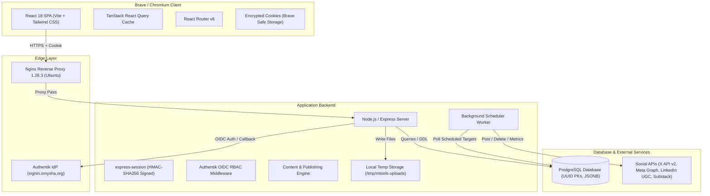

# MarketingSupport (mtools) — Reverse Engineering Dossier

Comprehensive reverse-engineering report and architectural blueprint of **MarketingSupport (`mtools.omysha.org`)**, an internal multi-brand social media marketing, content orchestration, and omnichannel publishing web application.

---

## 🎯 Executive Summary

**MarketingSupport (`mtools`)** is an enterprise-grade social media management platform built for **Omysha** organizations and initiatives (including *A4G*, *A4G Intelex*, *GMFER*, and *Muralidhar*). It coordinates the end-to-end lifecycle of marketing content:
1. **Multi-Brand Voice & Style Governance**: Configures brand personas, tones, Hindi-English blending rules, typography/palette tokens, and anti-patterns.
2. **Omnichannel Content Authoring**: Centralized post creation with tailored variant copy and image aspect ratios for **LinkedIn**, **X (Twitter)**, **Facebook**, **Instagram**, **Reddit**, and **Substack**.
3. **Editorial Workflow & Scheduling**: Kanban pipeline (`Draft` ➔ `Scheduled` ➔ `Published`) and calendar views backed by an automated background publishing worker.
4. **Publishing & Deletion Sync**: Synchronized cross-platform publishing with remote ID tracking (`urn:li:share`, Tweet IDs, Meta Graph API IDs) and bi-directional deletion.
5. **Unified Engagement Inbox**: Centralized feed for monitoring incoming social comments across accounts and posting approved direct replies.
6. **Cross-Platform Analytics & Rollups**: Aggregation of post metrics, impressions, and engagement rates across brands.

---

## 🏗️ System Architecture Overview

---

## 💻 Technology Stack

| Layer | Technology | Details / Versions Observed |
| :--- | :--- | :--- |
| **Reverse Proxy / Web Server** | **Nginx** | `nginx/1.28.3 (Ubuntu)` hosting at `139.84.159.115` |
| **Backend Runtime & Framework** | **Node.js + Express** | `X-Powered-By: Express`, Native ES modules |
| **Identity & Authentication** | **Authentik OIDC / OAuth2** | Hosted at `signin.omysha.org`, Google Workspace federation |
| **Session Store** | **express-session** | Cookie `mtools_session=s:<id>.<hmac>`, encrypted via client Safe Storage |
| **Database** | **PostgreSQL** | Native UUIDv4 keys, JSONB config/metadata, Timestamptz with microsecond precision |
| **File Storage** | **Local Disk / Inode** | Uploads saved to `/tmp/mtools-uploads/<uuid>.<ext>` |
| **Frontend Framework** | **React 18 (Vite build)** | Single-page bundle `index-D91f_Wlo.js` (689 KB, 34.5k formatted lines) |
| **Client-Side State** | **TanStack Query (v5)** | Query caching, automatic background invalidation, polling rollups |
| **Routing** | **React Router DOM v6** | Declarative route structure with protected layout wrappers |
| **Styling & Components** | **Tailwind CSS + Radix UI** | Modern utility-first CSS, Lucide React icon suite |

---

## 📂 Documentation Directory

| Document | Purpose |
| :--- | :--- |
| [ARCHITECTURE.md](file:///home/laptup/Dev/mtools/ARCHITECTURE.md) | Client-server architecture, Authentik SSO OIDC authentication flow, session security, Vite+React SPA architecture, and RBAC rules. |
| [DATABASE_SCHEMA.md](file:///home/laptup/Dev/mtools/DATABASE_SCHEMA.md) | Complete PostgreSQL schema DDL (`CREATE TABLE`), data types, relationships, constraints, indexes, and JSONB schemas. |
| [API_SPECIFICATION.md](file:///home/laptup/Dev/mtools/API_SPECIFICATION.md) | Exhaustive documentation of all 36+ REST API endpoints, HTTP methods, authentication headers, request/response models, and live examples. |
| [BRAND_AND_CONTENT_ENGINE.md](file:///home/laptup/Dev/mtools/BRAND_AND_CONTENT_ENGINE.md) | Brand voice configuration, multi-platform adaptations, media processing, social publisher adapters, engagement inbox, and audit logs. |

---

## 🔍 Key Discoveries & Security Observations

1. **Authentication Architecture**:
   - Single Sign-On (SSO) delegated to Authentik at `signin.omysha.org`.
   - Access tokens and user profiles are tied to Authentik groups (`product:omysha-mtools:editor`, `org:1`, `team:TechProducts`).
   - Browser cookies use `HttpOnly` and `Secure` attributes, with values encrypted in Brave using AES-128-CBC (`chrome_libsecret_os_crypt_password_v2`).
2. **Database Signatures**:
   - PostgreSQL is identified via unhandled UUID parsing exceptions (`ERROR: invalid input syntax for type uuid`), microsecond UTC timestamps (`YYYY-MM-DDTHH:MM:SS.ffffff+00:00`), and JSONB operators.
3. **Local Disk Storage**:
   - Image assets uploaded via `/api/content/:id/targets/:platform/image` are stored in `/tmp/mtools-uploads/` on the server filesystem.
4. **Resilient Publishing & Audit Trail**:
   - Every publish, deletion, import, and reply is permanently recorded in `publishing_logs` with raw third-party platform responses and error codes (e.g. X API 402/403 errors, Meta Graph API error nodes).
